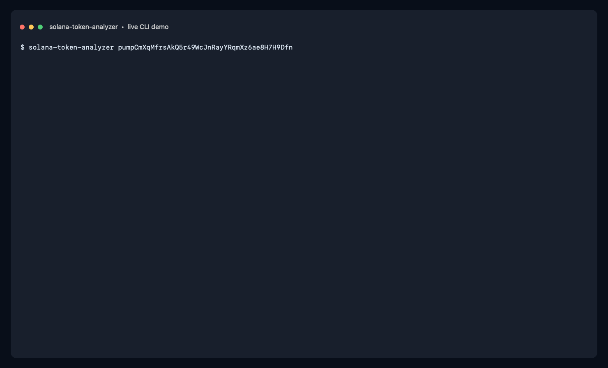

# Solana Token Analyzer

**A one-token-at-a-time research CLI for Solana.** Give it a ticker or mint
address and get a sourced snapshot of market activity, liquidity, holders, and
concentration risk — without scanning unrelated tokens or requiring API keys.

> Built for the Datacore Labs bounty.

## Why this analyzer

- **Analyze the token you choose.** No candidate universe, seed searches,
  market-cap filter, or scan scheduler.
- **Resolve tickers carefully.** A symbol must match exactly and identify one
  mint. If multiple Solana tokens share a ticker, the CLI refuses to guess and
  asks for the mint address.
- **One useful report.** Liquidity, market cap/FDV basis, 24-hour volume and
  trades, pool age, holder concentration, LP lock data, an explainable
  0–100 heuristic score, and explicit risk flags.
- **Know where every number came from.** Market/pair metrics come from
  DexScreener; holder and LP enrichment comes from RugCheck. Missing data stays
  `null` in JSON rather than being presented as zero.
- **Use it in a terminal or a pipeline.** Readable output by default; stable,
  indented JSON with `--json`. No API key, wallet, transaction signing, or
  third-party Python dependency required.

## Requirements

- Python 3.10 or newer
- Internet access to the public DexScreener and RugCheck APIs

## Install

From the repository root, create and activate a virtual environment with
[`uv`](https://docs.astral.sh/uv/):

```bash
uv venv .venv
source .venv/bin/activate
uv pip install -e .
```

The editable install adds the `solana-token-analyzer` command to the
environment. Activate it again in future terminal sessions with
`source .venv/bin/activate`. You can also run the tool as a Python module:

```bash
python -m solana_token_analyzer.cli PUMP
```

## Run

Analyze a ticker (when it resolves to a single mint):

```bash
solana-token-analyzer PUMP
```

Popular symbols can match multiple Solana mints. If `PUMP` or another ticker
matches several tokens in DexScreener search, the CLI prints the candidate
mints and exits rather than risk analyzing a lookalike.

Analyze a mint address (recommended when a ticker is shared or unknown):

```bash
solana-token-analyzer pumpCmXqMfrsAkQ5r49WcJnRayYRqmXz6ae8H7H9Dfn
```

Live CLI demo (captured from a public API snapshot; metrics can change):



Example output:

```text
$ solana-token-analyzer pumpCmXqMfrsAkQ5r49WcJnRayYRqmXz6ae8H7H9Dfn

PUMP — Pump
Mint: pumpCmXqMfrsAkQ5r49WcJnRayYRqmXz6ae8H7H9Dfn
Pair: pumpswap | https://dexscreener.com/solana/2uf4xh61rdwxng9woyxsvqp7zua6klfpb3nvnrqeoisd
Observed: 2026-10-18T18:32:47.452399+00:00

MARKET
  Market cap: $1,902,931,766.00
  Liquidity: $22,599,247.06
  24h volume: $3,373,594.73
  Volume / market cap: 0.0017728406190261686
  Liquidity / market cap: 0.01187601545351469
  24h buys / sells: 7161 / 8460
  Pool age: 11,065.62 hours

RISK & HOLDERS
  Holders: 1090370
  Creator balance: unknown
  LP locked: 100.0%
  Social links: 2
  Score: 32/100 (risk_review)
    holder distribution: 0
    holder growth: 20
    volume quality: 2
    liquidity safety: 10
    social reflexivity: 0
  Risk flags: single_unlabeled_holder_gt_20pct, top10_holders_gt_50pct
  Sources: DexScreener, RugCheck
  Data coverage: 14/18 key metrics
  RugCheck report: https://api.rugcheck.xyz/v1/tokens/pumpCmXqMfrsAkQ5r49WcJnRayYRqmXz6ae8H7H9Dfn/report
  Warning: Social-mention data is unavailable; the social score component is zero.
```

Get machine-readable JSON:

```bash
solana-token-analyzer PUMP --json
solana-token-analyzer PUMP --json > pump-report.json
```

See all options:

```bash
solana-token-analyzer --help
```

Ticker matching is case-insensitive but otherwise exact. If there are several
matching mints, use the mint address printed with each candidate. A mint may
have multiple DEX pools; the analyzer uses its most liquid pair to avoid
double-counting the token or arbitrarily selecting a thin pool.

## What the report contains

| Metric | Meaning |
| --- | --- |
| Market cap / FDV | USD valuation from DexScreener; `valuation_basis` says whether it is reported market cap or the FDV fallback. |
| Liquidity | USD liquidity in the selected pair. |
| 24h volume and buys/sells | Activity in the selected pair over the preceding 24 hours, as reported by DexScreener. |
| Pool age | Elapsed time since the selected pair was created. This is not necessarily the token's mint age. |
| Holder count | RugCheck report data. Top-holder concentration is used internally for the score and risk flags but is not shown as a separate output metric. |
| LP locked % | Highest LP lock percentage reported for the token's RugCheck markets. It is not a guarantee of safety. |
| Score and components | A transparent adaptation of the source scanner's five-component heuristic (holder distribution, holder count, volume quality, liquidity safety, and social signals). |
| Risk flags | Holder concentration and low/unknown LP-lock status. This provider set does not independently detect bundled buys; that metric remains `null`. |
| Data coverage and warnings | Shows missing enrichment and source errors so partial reports are not mistaken for complete ones. |

The score is a research aid, **not investment advice or a prediction**. Social
mentions are not inferred from links, and the social component is zero when
mention data is unavailable. Holder count contributes to the scanner's
holder-growth component even though a single lookup cannot measure growth; this
is intentionally visible in the component breakdown. Missing holder data is
reported as unknown and lowers coverage rather than being fabricated.

Public endpoints can rate-limit, change schemas, or return incomplete data.
DexScreener is required to identify and price a token; if it is unavailable the
command exits with an error. RugCheck is an optional enrichment: its failure
is included in report warnings while the market snapshot is still returned.

## JSON shape

`--json` writes one object to standard output. Metrics unavailable from the
selected pair or enrichment source are `null`.

```json
{
  "input": "PUMP",
  "token": {
    "symbol": "PUMP",
    "name": "Pump",
    "mint": "...",
    "pair_address": "...",
    "dex_id": "raydium",
    "pair_url": "https://dexscreener.com/solana/...",
    "observed_at": "2026-10-18T18:00:00+00:00"
  },
  "metrics": {
    "market_cap_usd": 0,
    "valuation_basis": "market_cap",
    "liquidity_usd": 0,
    "volume_24h_usd": 0,
    "buys_24h": 0,
    "sells_24h": 0,
    "volume_to_mcap": 0.0,
    "liquidity_to_mcap": 0.0,
    "pool_age_hours": 0.0,
    "social_links": 0,
    "social_mentions_1h": null,
    "kol_mentions_1h": null,
    "holders": null,
    "lp_locked_pct": null
  },
  "analysis": {
    "score": 0,
    "verdict": "ignore",
    "components": {},
    "risk_flags": []
  },
  "sources": ["DexScreener", "RugCheck"],
  "source_urls": {
    "dexscreener": "https://dexscreener.com/solana/...",
    "rugcheck": "https://api.rugcheck.xyz/v1/tokens/.../report"
  },
  "data_coverage": {
    "available": 14,
    "total": 18
  },
  "warnings": []
}
```

Values above are illustrative only; the real report includes the full metric
set.

## Score rubric

The inherited scanner rubric totals five components: holder distribution
(0–30), holder count (0–20), volume quality (0–20), liquidity safety (0–15),
and social reflexivity (0–15). The original verdict bands are `watchlist`
(75+), `monitor` (60–74), and `ignore` (below 60); severe top-holder
concentration caps the score and returns `risk_review`. The full component scores and flags are printed so the total is auditable. Data
gaps can lower the score; compare coverage and warnings before comparing tokens.

## Development

Run the standard-library unit tests:

```bash
python -m unittest discover -s tests -v
```

Regenerate the animated demo on macOS after activating the environment:

```bash
solana-token-analyzer pumpCmXqMfrsAkQ5r49WcJnRayYRqmXz6ae8H7H9Dfn > /tmp/token-report.txt 2>&1
swift scripts/render_demo.swift /tmp/token-report.txt docs/assets/token-analysis-demo.gif
```

## Use as an agent skill

This repository includes a reusable
[Solana Token Analysis skill](.github/skills/solana-token-analysis/SKILL.md).
When you ask a compatible coding agent to analyze a Solana token, the skill
instructs it to run this CLI, preserve source warnings and unknown metrics, and
ask you to choose a mint rather than guess when a ticker is ambiguous.

The skill uses the open `SKILL.md` format, but agent harnesses discover
project-local skills from different directories. Copy the skill folder into
the directory used by your harness:

| Harness | Project skill directory |
| --- | --- |
| VS Code / GitHub Copilot | `.github/skills/` (already included) |
| OpenAI Codex | `.agents/skills/` |
| Claude Code | `.claude/skills/` |
| OpenCode | `.opencode/skills/` |

For example, to enable the skill in Codex from the repository root:

```bash
mkdir -p .agents/skills
cp -R .github/skills/solana-token-analysis .agents/skills/
```

For Claude Code or OpenCode, substitute `.claude/skills` or
`.opencode/skills` for `.agents/skills`:

```bash
mkdir -p .claude/skills
cp -R .github/skills/solana-token-analysis .claude/skills/
```

Then install the CLI in the repository environment using the steps in
[Install](#install). Ask your agent to analyze a ticker or mint, for example:
“Use the Solana Token Analysis skill to analyze PUMP.” The agent must be
configured to run terminal commands in this repository. Skill discovery,
invocation, and approval settings depend on each harness; see the official
guides for [Codex](https://developers.openai.com/codex/skills/),
[Claude Code](https://code.claude.com/docs/en/skills), and
[OpenCode](https://opencode.ai/docs/skills/).

## Data and safety notes

- This is read-only analysis. It never asks for a seed phrase/private key,
  connects a wallet, or submits a transaction.
- Requests send the ticker or mint to the public data providers to retrieve
  token information.
- Metrics reflect public API snapshots and can be stale or inaccurate. Verify
  critical details on-chain and with the source links.
- A high score, locked-liquidity reading, or absence of flags does not establish
  that a token is legitimate or safe.

## Next Steps
- add more data sources, metrics 
- build a UI 

